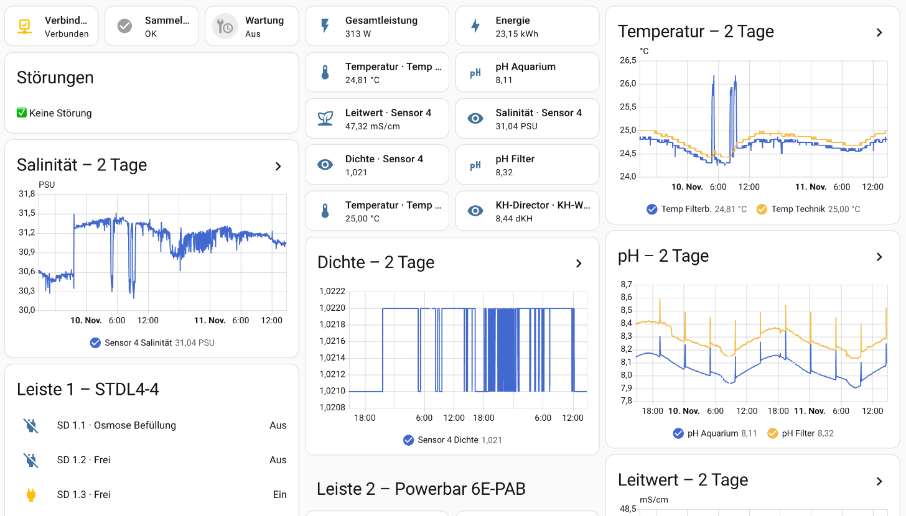
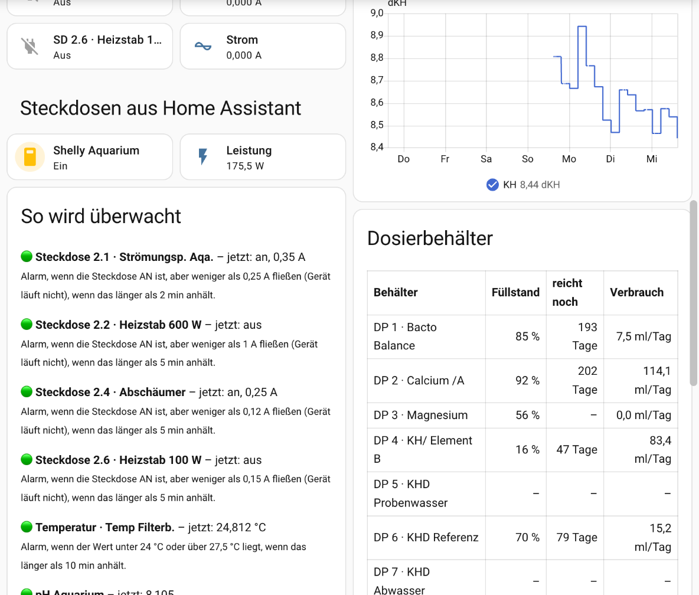
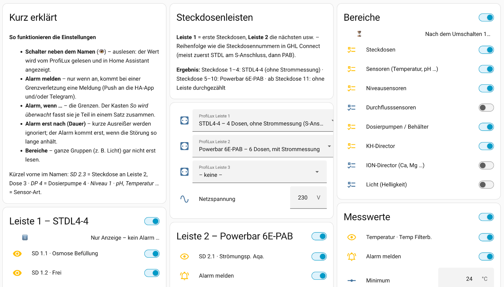

# Aquarium-Wächter – GHL ProfiLux 4 in Home Assistant

**🇩🇪 Deutsch** · [🇬🇧 English](README.en.md)

### 🐠 Bring dein Aquarium auf das nächste Level.
*Take your aquarium to the next level.*

**Verbindet GHL ProfiLux 4 in wenigen Minuten mit Home Assistant** – ohne YAML und ohne
eigene Sensoren: alle Werte automatisch in HA, Überwachung von Pumpen, Sonden,
KH-Director und Dosierern – und ein **Alarm aufs Handy, der auch nachts im Stumm-Modus klingelt**,
bevor aus einer ausgefallenen Pumpe ein Notfall wird.

> 🍖 **Dieses Add-on ist kostenlos – und soll es bleiben.** Wenn es dir eine schlaflose
> Nacht oder sogar ein Becken erspart, spendier mir einen Schweinebraten (bin ja aus Bayern). Das hält das Projekt
> am Leben und finanziert neue Funktionen.
>
> <a href="https://buymeacoffee.com/gutgeschaltet"></a>

> 🌍 **English · Français · Español · Italiano:** Home Assistant add-on for **GHL ProfiLux 4**
> aquarium controllers – all values in HA, monitoring of pumps, probes, KH Director, dosers
> and Shelly plugs, **critical push alarms** (HA app, rings in silent mode) or Telegram,
> “refill in … days” for dosing containers, weekly report and total power/energy.
> Dashboard and alarms in **5 languages** – automatically in your Home Assistant language.
> **→ [Full English README](README.en.md)**

Home-Assistant-Add-on, das einen oder mehrere Aquariencomputer **GHL ProfiLux 4**
(Meer- und Süßwasser) über die lokale GHL-API überwacht – mit Alarm aufs Handy (HA-App und/oder Telegram):

- Alle Werte in Home Assistant: Steckdosen (Zustand, Strom – gruppiert nach Leiste),
  Sensoren (Temperatur, pH, Leitwert/Salinität, Redox …), Niveau, Durchfluss,
  KH-Director, ION-Director, Füllstände der Dosierbehälter (ml und %), Licht
  (Helligkeit je Kanal). Was genau geht und was nicht: [Was wird ausgelesen?](https://github.com/ghefs/aquarium-waechter/wiki/Was-wird-ausgelesen)
- **Alarm aufs Handy**, wenn etwas nicht stimmt – als **kritische Benachrichtigung** der
  HA-App (klingelt auch nachts im Stumm-Modus) und/oder per Telegram: Pumpe steht (zu wenig Strom),
  Temperatur außerhalb der Grenzen, Dosierbehälter fast leer, keine KH-Messung mehr,
  ProfiLux nicht erreichbar. Mit Verzögerung, Erinnerung und „Wieder OK“
- **Steckdosen aus Home Assistant mit überwachen:** Weitere Pumpe oder externes Licht an
  einer **Shelly Plug S** (oder einer anderen Steckdose mit Leistungsmessung)? Auf der
  Einstellungsseite einschalten – sie steht im Dashboard und wird wie eine ProfiLux-Steckdose
  überwacht (zu wenig/zu viel Leistung, nicht erreichbar)
- **Gesamtleistung und Energie** des Aquariums (W, kWh – auch fürs Energie-Dashboard von HA)
- **Wochenbericht** aufs Handy: Mittel/Min/Max der Messwerte, Verbrauch und Vorrat der
  Dosierbehälter, Störungen der Woche
- **Wartungsmodus:** Ein Schalter pausiert die Alarme, solange man am Becken arbeitet
- **Optional: ProfiLux und Mitras aus HA steuern** – Wartung, Futterpause, Wasserwechsel, Lichtszenen, Gewitter,
  Master-Helligkeit, KH-/ION-Director-Aktionen und (zweite Freigabe) Sollwerte, Lichtkurven und Namen
  (Standard aus, siehe [unten](#optional-profilux-und-mitras-aus-home-assistant-steuern))
- **Alles in HA einstellbar:** was abgefragt wird, was überwacht wird, Grenzwerte
- **Dashboard wird automatisch erzeugt** – eine Übersicht und eine Einstellungsseite je ProfiLux
- **Fünf Sprachen:** Deutsch, English, Français, Español, Italiano – Dashboard, Entitäten und
  Meldungen automatisch in der Sprache von Home Assistant (Option `sprache`)
- Beliebig viele ProfiLux, jeder mit eigener Ausstattung (1 oder 6 Steckdosenleisten,
  2 oder 12 Dosierer …). Erkannt wird automatisch, was vorhanden ist

Telegram-Alarme schickt das Add-on **direkt** an Telegram – sie kommen also auch dann,
wenn Home Assistant selbst gerade hängt. Wer ganz sicher gehen will, nutzt beides.

### So sieht es aus

**Übersicht** – Status, Gesamtleistung, Messwerte mit Verlauf, Steckdosenleisten mit An/Aus und Strom:



<table><tr>
<td width="50%"><b>Dosierbehälter</b> – Füllstand, „reicht noch … Tage“, Verbrauch; daneben „So wird überwacht“ in Klartext:<br></td>
<td width="50%"><b>Einstellungen</b> – alles per Klick, ohne YAML: Leisten, Bereiche, Grenzwerte, Alarm-Verzögerung:<br></td>
</tr></table>

### Warum dieses Projekt?

Weil am Wochenende unbemerkt eine Pumpe ausgefallen ist. Der Aquariencomputer regelt
zuverlässig – aber er sagt einem nicht unbedingt, **dass ein Gerät gar nicht läuft**.
Genau diese Lücke schließt der Aquarium-Wächter:

- **Ausgänge wirklich überwachen:** Steckdose ist AN, aber die Pumpe zieht keinen
  Strom? → Alarm. Strom plötzlich zu hoch (blockierte Pumpe)? → Alarm.
- **KH-Director im Blick:** Seit Stunden keine Messung mehr (Reagenz leer, Schlauch
  verstopft)? → Alarm. Ab Firmware 7.52 zusätzlich Leck- und Messbereichsalarm.
- **Sensorfehler:** Sonde liefert keinen gültigen Wert mehr? → Alarm (ab Firmware 7.52).
- **Dosierbehälter:** Verbrauch je Tag und **„reicht noch … Tage“** – Meldung „Nachfüllen“
  rechtzeitig, bevor der Behälter leer ist. Ab Firmware 7.52 auch die **letzte Dosierung**
  (Zeit und ml).
- **ProfiLux weg** (Stromausfall, WLAN, API nach Firmware-Update aus)? → Alarm.
- Alles mit Verzögerung gegen Fehlalarme, Erinnerung und „Wieder OK“ – aufs Handy,
  per HA-App und/oder Telegram.

**Aktiv gepflegt:** Ich betreue selbst Aquarien mit ProfiLux und nutze das Add-on dort
jeden Tag. Solange das so ist, wird es weiterentwickelt und gepflegt – mit Updates,
Fehlerkorrekturen und Anpassungen an neue Firmware.

> **Kein offizielles Produkt von GHL.** Unabhängiges Open-Source-Projekt, nicht mit
> GHL Advanced Technology verbunden oder von GHL unterstützt. „GHL“, „ProfiLux“ und
> „GHL Connect“ sind Marken ihrer jeweiligen Inhaber und werden hier nur verwendet,
> um zu beschreiben, mit welchen Geräten das Add-on funktioniert.
> Ausgänge werden nur gelesen, niemals geschaltet.

> ⚠️ **Nutzung auf eigene Gefahr – siehe [Haftungsausschluss](#haftungsausschluss).**
> Das Add-on ist eine zusätzliche Überwachung und **kein Ersatz** für die
> Schutzfunktionen des ProfiLux und unabhängige Sicherungen am Becken.

**→ [Schnellstart](#schnellstart)** · 📖 [Wiki mit allen Details](https://github.com/ghefs/aquarium-waechter/wiki) · 🍖 [Projekt unterstützen](#unterstützen)

## Schnellstart

> Voraussetzung: Home Assistant **OS** (oder „Supervised“) und ein **Backup** vorher
> (*Einstellungen → System → Backups*).

1. **GHL-API einschalten** – in GHL Connect unter *System → GHL API* („Nur lesen“ genügt; nur die
   [optionale Steuerung](#optional-profilux-und-mitras-aus-home-assistant-steuern) braucht „Voller Zugriff“).
   Nach jedem Firmware-Update ist sie wieder aus. Der ProfiLux braucht eine feste IP-Adresse.
2. **MQTT:** *Einstellungen → Add-ons → Add-on-Store* → **Mosquitto broker** installieren
   und starten, dann unter *Geräte & Dienste* „MQTT gefunden“ → **Konfigurieren**.
3. **Repository hinzufügen** und **Aquarium-Wächter** installieren:

   [](https://my.home-assistant.io/redirect/supervisor_add_addon_repository/?repository_url=https%3A%2F%2Fgithub.com%2Fghefs%2Faquarium-waechter)

4. Reiter **Konfiguration** → ProfiLux eintragen → Speichern → **Starten**:

   ```yaml
   geraete:
     - name: Riff
       host: 192.168.1.50
   ```

5. Dashboard **Aquarium** in der Seitenleiste → Einstellungsseite:
   **Steckdosenleisten** wählen, festlegen, **was überwacht wird**, unter
   **„Alarm aufs Handy“** das eigene Handy einschalten → **„Test-Alarm senden“**. 📱

Schritt für Schritt mit Erklärungen: **[Wiki → Installation](https://github.com/ghefs/aquarium-waechter/wiki/Installation)**.

> Die GHL-API bedient **nur einen Client gleichzeitig** – andere Abfragen desselben
> ProfiLux (alte `tcp`-Sensoren, Node-RED …) müssen weg.

## Dokumentation (Wiki)

| Thema | |
|---|---|
| Installation, MQTT, Updates, Deinstallieren | [Installation](https://github.com/ghefs/aquarium-waechter/wiki/Installation) |
| Push an die HA-App (kritischer Alarm), Telegram, Chat-ID | [Benachrichtigungen](https://github.com/ghefs/aquarium-waechter/wiki/Benachrichtigungen) |
| Dashboard, Namen und Kürzel, Überwachung einstellen | [Dashboard und Einstellungen](https://github.com/ghefs/aquarium-waechter/wiki/Dashboard-und-Einstellungen) |
| Steckdosenleisten (STDL, Powerbar-PAB) zuordnen | [Steckdosenleisten](https://github.com/ghefs/aquarium-waechter/wiki/Steckdosenleisten) |
| Was geht, was nicht (Lücken der GHL-API) | [Was wird ausgelesen](https://github.com/ghefs/aquarium-waechter/wiki/Was-wird-ausgelesen) |
| Eingebaute Meldungen, Blueprints, Sicherheitsnetz | [Fertige Automationen](https://github.com/ghefs/aquarium-waechter/wiki/Fertige-Automationen) |
| **Alle Entitäten, eigene Automationen, Beispiele** | [Entitäten und Automationen](https://github.com/ghefs/aquarium-waechter/wiki/Entitäten-und-Automationen) |
| Alle Optionen des Add-ons | [Add-on-Optionen](https://github.com/ghefs/aquarium-waechter/wiki/Add-on-Optionen) |
| Telegram-Befehle `/aq …`, Shelly-Steckdosen | [Telegram-Befehle und Shelly](https://github.com/ghefs/aquarium-waechter/wiki/Telegram-Befehle-und-Shelly) |
| Probleme lösen | [Fehlersuche](https://github.com/ghefs/aquarium-waechter/wiki/Fehlersuche) |

Was sich geändert hat: [Änderungsprotokoll](aquarium_waechter/CHANGELOG.md).

## Entwicklung

Bei jedem Push auf `main`, der den Ordner `aquarium_waechter/` ändert, baut GitHub
Actions die Images `ghcr.io/ghefs/{aarch64,amd64}-aquarium-waechter:<version>`.
Neue Version: `version` in `config.yaml` erhöhen, Eintrag in `CHANGELOG.md`, pushen –
nach ca. 3 Minuten steht das Update bereit.

Nur Python-Standardbibliothek. Lokal testen mit Simulatoren:

```sh
python3 tests/sim_ghl.py 19001 klein &
python3 tests/sim_ghl.py 19002 gross &
python3 tests/sim_mqtt.py 19883 &
cd aquarium_waechter && python3 -m waechter ../tests/options.json --data ../tests/_tmp
```

GHL-API-Kurzreferenz: Klartext über TCP 10002, `GET SWITCHCHANNEL[n] ACTSTATE`,
`… ACTCURRENT`, `… DESCRIPTION`, `GET SENSOR[n] ACTVALUE[u]`, `GET DOSER[n] FILLLEVEL`,
`GET KHDIRECTOR ACTVALUE`, `GET KHDIRECTOR DATARECORD[0]` (Zeit der letzten Messung).
Antworten `ACK <…>` / `NACK (code)`; Indizes ab 0.

## Optional: ProfiLux und Mitras aus Home Assistant steuern

Standardmäßig **liest** das Add-on nur. Wer will, kann je Gerät zwei Freigaben einschalten – alles über die
dokumentierten Schreibbefehle der **offiziellen GHL-API**:

| Freigabe (je Gerät in der Add-on-Konfiguration) | Was dann in HA erscheint |
|---|---|
| `steuerung: true` – **Aktionen** | Wartungsmodus 1–4, Futterpause 1–4, Wasserwechsel 1–4 (pausieren die Alarme), Lichtszenen 1–8 (mit Überblendzeit), Gewitter (Dauer, Start/Stopp), **Master-Helligkeit**, Aktionen von **KH-Director** (Messung, Schlauch entlüften, Messzelle spülen/leeren, Stopp) und **ION-Director** |
| `einstellungen_schreiben: true` – **dauerhafte Änderungen im Gerät** | **Sollwerte** (Sensoren, KH, ION), **Lichtkurven** (Text `06:30=0, 08:00=40, …`), **Namen** (höchstens 16 Zeichen; in HA zunächst deaktiviert) |

1. In GHL Connect unter *System → GHL API* auf **„Voller Zugriff“** stellen. Bei „Nur lesen“ lehnt der ProfiLux
   jeden Schreibbefehl mit `NACK (-105)` ab; das Add-on weist dann in einer Meldung darauf hin.
2. Die gewünschte Freigabe beim Gerät in der Add-on-Konfiguration auf `true` setzen (Standard: aus).
3. Das Dashboard bekommt eine Karte **„Steuerung“** bzw. **„Einstellungen im Gerät ändern“** – nur dann, wenn die Freigabe gesetzt ist.

**Sicherheit der dauerhaften Änderungen:** Sollwerte werden nur im plausiblen Bereich je Sensorart angenommen
(z. B. Temperatur 10–35 °C, pH 6–9,5) und nur in kleinen Schritten geändert (höchstens ±3 K, ±0,5 pH, ±20 % …
je Änderung). Lichtkurven werden geprüft (Zeiten aufsteigend, höchstens 24 Punkte, 0–100 %), nach dem Schreiben
zurückgelesen und bei einem Fehler auf den alten Stand zurückgesetzt. Namen: nur Buchstaben ohne Umlaute, Ziffern
und einfache Satzzeichen.

**Wartung, Futterpause, Wasserwechsel** pausieren die Alarme für die eingestellte Dauer („Wartung – Dauer“,
`futterpause_min` Standard 15, `wasserwechsel_min` Standard 60 Minuten) – stelle sie passend zur Dauer in GHL Connect ein.
Der ProfiLux meldet den Zustand dieser Funktionen **nicht zurück**: Die Schalter zeigen einen angenommenen Zustand und
springen nach der Dauer von selbst zurück; am ProfiLux wird dabei nichts gesendet.

**Mitras-Leuchten** (LX7/LX8) werden erkannt (Option `typ`: `auto`, `profilux`, `mitras`): Lichtkanäle, Kühlkörper-Temperatur,
Lichtszenen, Gewitter, Wartung, Master-Helligkeit und Lichtkurven. Zusätzlich zeigt das Add-on die **Abweichung der Geräteuhr** an.

> **Sicherheit:** „Voller Zugriff“ hat keine Anmeldung – jedes Gerät im Netz, das den ProfiLux erreicht, kann dann
> Funktionen auslösen. Die GHL-Dokumentation empfiehlt „Nur lesen“, wenn man nichts schreiben muss.
> ProfiLux nur in einem Netz betreiben, das du kontrollierst, und Port 10002 nie ins Internet weiterleiten.

## An das GHL-Team 👋

Danke für die offene GHL-API – ohne sie gäbe es dieses Projekt nicht. Das Add-on nutzt
**ausschließlich die offizielle API** und liest standardmäßig nur (Wartung und Futterpause
auslösen ist eine ausdrücklich zuschaltbare Option). Einige Informationen,
die GHL Connect anzeigt, sind über die API (noch) nicht abrufbar. Schön wäre:

1. **Steckdosenleisten:** zu welcher Leiste (PAB, STDL …) eine Steckdose gehört
2. **Alarmliste des ProfiLux:** aktive Alarme und Meldungen wie in GHL Connect
3. **Wartung und Futterpause:** Zustand lesen (aktiv? wie lange noch?)
4. **Sensor-Art und Einheiten:** pH, Redox, Temperatur …; Einheit beim Durchfluss
5. **ION-Director:** Bezeichnung der Messwerte (Ca, Mg …)
6. **Dosierer:** eingestellte Dosiermengen und -zeiten
7. **Timer und Pumpen:** Schaltzeiten und aktuelle Strömungsprogramme
8. **Netzüberwachung (LinMon):** Stromausfall-Status, damit HA ihn melden kann
9. **Mehrere Clients gleichzeitig** – z. B. Home Assistant und ein weiteres Tool
10. *Später:* **Schreibzugriff mit Anmeldung** (heute gibt es nur „Voller Zugriff“ ohne Passwort), damit sich Funktionen wie Wartung sicherer auslösen lassen

Neue Firmware mit solchen Erweiterungen teste ich gern an echten Becken – Kontakt
über die [Issues](https://github.com/ghefs/aquarium-waechter/issues).
Was heute schon geht: [Was wird ausgelesen?](https://github.com/ghefs/aquarium-waechter/wiki/Was-wird-ausgelesen)

## Unterstützen

Das Add-on ist kostenlos und bleibt es. Hinter jeder Version stecken viele Abende
Entwicklung und Tests am echten Becken. Wenn es dir hilft – oder vielleicht sogar
ein Becken gerettet hat – freue ich mich über einen Schweinebraten – oder wenigstens einen Kaffee:

<a href="https://buymeacoffee.com/gutgeschaltet"></a>

Genauso wertvoll: ⭐ für das Repo, Fehler melden und Erfahrungen mit anderen
ProfiLux-Ausstattungen teilen (Issues).

## Haftungsausschluss

Dieses Projekt wird **ohne jede Gewährleistung** bereitgestellt, und die Nutzung
erfolgt **auf eigene Gefahr**. Für Schäden jeglicher Art – insbesondere an Tieren,
Pflanzen, Aquarium, Technik, Gebäude oder Daten, für Folgeschäden sowie für
ausgebliebene, verspätete oder falsche Meldungen – wird **keine Haftung**
übernommen, soweit gesetzlich zulässig.

Bitte beachten:
- Eine Überwachung kann ausfallen: Stromausfall, WLAN/Netzwerk, Home Assistant,
  Telegram, Internet, Firmware-Updates des ProfiLux (GHL-API danach wieder aus) usw.
  Ausbleibende Meldungen bedeuten **nicht**, dass alles in Ordnung ist.
- Das Add-on ersetzt **keine** Schutzeinrichtungen: Heizstab mit eigenem
  Thermostat, Niveau-/Überlaufschutz, Fehlerstrom-Schutzschalter, Rauchmelder,
  regelmäßige Sichtkontrolle.
- Grenzwerte und Einstellungen liegen in der Verantwortung des Nutzers.
- Vor Installation und Updates ein Backup von Home Assistant erstellen.

Rechtlich maßgeblich ist die [MIT-Lizenz](LICENSE) („THE SOFTWARE IS PROVIDED
"AS IS", WITHOUT WARRANTY OF ANY KIND …“).

## Stichworte

GHL ProfiLux 4, ProfiLux 3, GHL Connect, Aquariencomputer, Aquarium Controller,
Riffaquarium, Meerwasseraquarium, KH Director, Doser, Dosierpumpe, Home Assistant
Add-on, MQTT, Telegram, Pumpenüberwachung, Aquarium Alarm, aquarium controller, reef tank,
saltwater aquarium, dosing pump, pump monitoring, critical notification,
Shelly Plug S, Verbrauch Dosierpumpe, Wochenbericht, Stromverbrauch Aquarium

## Lizenz

MIT – siehe [LICENSE](LICENSE). Marken: siehe Hinweis oben.
